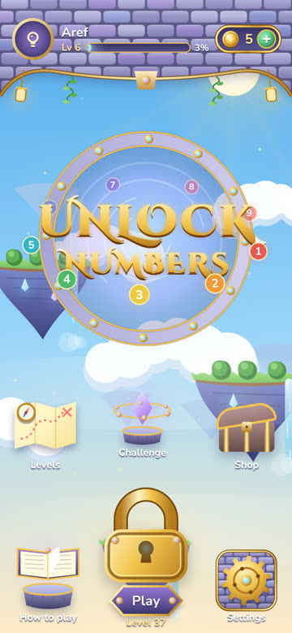
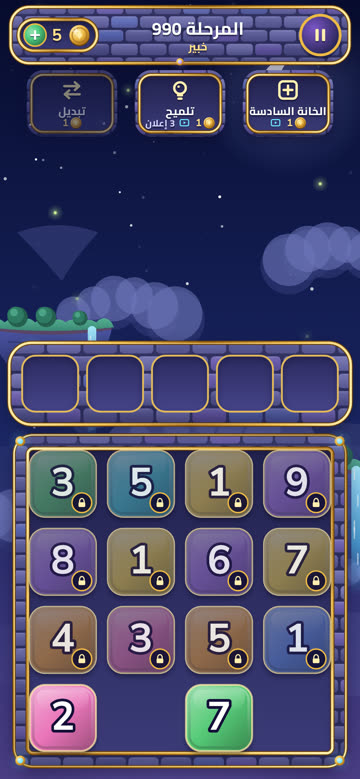
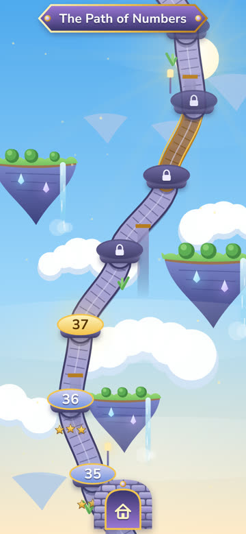
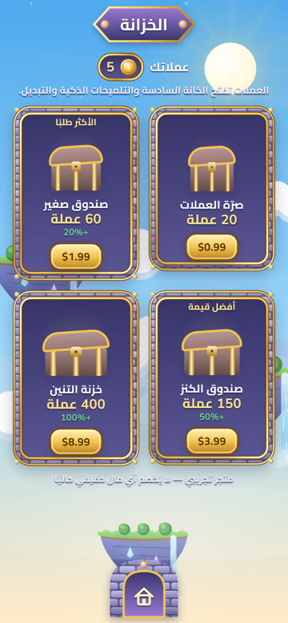

# Unlock Numbers — حرّر الأرقام

لعبة ألغاز منطقية هادئة بعالم خيالي من الأحجار والذهب والجزر المعلّقة.
مبنية بـ **Flutter** لتعمل على **Android وiOS والويب**، ويمكن تثبيتها على الجهاز كتطبيق ويب (**PWA**).

<p align="center">
  
  
  
  
</p>

**العب على الويب:** https://binaref.github.io/number-unlock/

## فكرة اللعبة

- **في البداية:** بعض القطع مفتوحة (غالباً في الصف السفلي)، وبقيتها مغلقة لكن أرقامها ظاهرة.
- **السحب:** القطعة المسحوبة تنتقل إلى **خانات الاستقبال الخمس**، وتفتح فقط القطع المغلقة التي تشير إليها **أسهمها** (سهم أو سهمان). **النجمة** لا تفتح شيئاً، والفتح لا يتسلسل.
- **ثبات الشبكة:** لا شيء يتحرك فيها، ومكان القطعة المسحوبة يبقى فارغاً.
- **المطابقة:** رقمان **متساويان** أو **مجموعهما 10** يختفيان إذا تجاورا في الخانات. بعد كل مطابقة تتقارب القطع، وقد تتكون مطابقات متسلسلة.
- **الفوز:** تفريغ الشبكة والخانات معاً.
- **الخسارة:** امتلاء الخانات كلها دون أي مطابقة.

**ثلاث مساعدات:**
- الخانة السادسة، بعملة أو بإعلان.
- التلميح الذكي، بعملة أو بإعلان حتى 3 مرات.
- التبديل، بعملة ومرة واحدة في المرحلة.

**نمطان للعب:**
- **مراحل لا نهائية** متطابقة عند كل اللاعبين في العالم، تُصاغ على الجهاز من بذرة ثابتة وتتدرج حتى شبكات 10×10 بممرات وحل وحيد.
- **تحدٍّ لا نهائي** يولّد لغزاً جديداً في كل مرة ويمنح النقاط بحسب القرب من الحل المثالي، مع حفظ أعلى نقاط.

## المزايا التقنية

- **منطق نقي منفصل** في `lib/core`، بلا أي اعتماد على Flutter: الشبكة، الفتح، الخانات، محرك القواعد، معالج المطابقات، محرك الحل، المولّد، محلل الصعوبة، التلميحات، المساعدات، التحديات، العملات.
- **محرك قواعد مبني على البيانات** في `assets/config/rules.json`. تُضاف قاعدة جديدة من الملف دون تعديل منطق اللعبة. قاعدة الثلاثة أرقام المختلفة الألوان ومجموعها 10 موجودة الآن لكنها معطّلة.
- **محرك حل دقيق**، فهو بحث بالحالات مع ذاكرة ويعطي النتيجة نفسها على الجوال والويب. يستخدمه المولّد والتلميحات وتحليل الإنقاذ.
- **صعوبة مُثبتة رياضياً:**
  - كل مرحلة تُحل بالخانات الخمس دون مساعدات.
  - حين تُصنَّف مرحلة بأنها تحتاج 4 أو 5 خانات، يُثبت المحرك أن عدداً أقل لا يكفي.
  - المولّد يصلّب الألغاز موجَّهاً بعدد طرق الحل حتى يصل إلى الهدف.
- **لا نص صريح ولا لون صريح في الكود:** النصوص في `assets/i18n`، والثيمات في `assets/themes`، ومقاسات التصميم وتوقيتات الحركة في `assets/design/tokens.json`.
- **رسومات مرسومة بالكود على طبقات:** سماء وشمس أو قمر ونجوم، جزر معلقة وشلالات وضباب ويراعات، أحجار وذهب وبلّورات. لذلك تتمدد الإطارات بلا تشويه، والنهار والليل تصميم واحد يتغير فيه الضوء فقط.
- **أصوات هادئة مولّدة برمجياً:** لكل رقم نغمة على السلّم الخماسي، وموسيقى محيطية للنهار وأخرى لليل.

## التشغيل

```bash
flutter pub get
flutter run                 # جهاز أو محاكي
flutter run -d chrome       # الويب
flutter test test           # اختبارات المنطق + التحقق من كل المراحل الألف
```

البناء:

```bash
flutter build appbundle --release     # Google Play (AAB)
flutter build ipa --release           # App Store
flutter build web --release --no-web-resources-cdn --base-href /number-unlock/
```

## النشر على GitHub Pages ثم على موقعك

- كل دفع (push) إلى `main` يشغّل `.github/workflows/deploy-web.yml`، الذي يختبر اللعبة ثم يبنيها وينشرها على Pages.
- **للنقل إلى موقعك:** ابنِ بـ `--base-href /` إن كانت اللعبة في جذر النطاق، أو بـ `--base-href /games/unlock/` إن كانت في مجلد فرعي، ثم ارفع محتوى `build/web`. استبدل `__BUILD__` في `sw.js` برقم إصدار جديد عند كل نشر.
- **PWA:** التثبيت متاح من قائمة المتصفح، ومن «الإعدادات ← تثبيت التطبيق»، واللعبة تعمل دون إنترنت بعد أول زيارة.

## هيكل المشروع

```
lib/
  core/        منطق اللعبة النقي (قابل للاختبار والتشغيل في الأدوات)
  services/    الحفظ، اللغات، الثيمات، الصوت، الإعلانات، المشتريات، الجدولة
  ui/          نظام التصميم: الرسامون، المكونات، العالم الخلفي، القطع
  features/    الصفحات: الرئيسية، الخريطة، التحدي، اللعب، الإعدادات، التعليمات، المتجر
assets/
  config/      القواعد، الاقتصاد، المتجر، منحنيات الصعوبة، إعدادات التطبيق
  i18n/        languages.json + ar/en/tr
  themes/      themes.json + day/night
  design/      tokens.json (الحركة والمقاسات)
  levels/      index.json + حزم المراحل (pack_001…010)
  audio/       المؤثرات والموسيقى (مولّدة)
tool/          generate_levels / generate_audio / probe_generator
test/          اختبارات المنطق والمراحل
test_visual/   لقطات الصفحات وتوليد الأيقونات
```

## التوسعة

| المطلوب | الخطوات |
|---|---|
| **لغة جديدة** | أضف `assets/i18n/xx.json` (انسخ `en.json`) وسطراً في `languages.json` يحدد الاسم والاتجاه والخط وقاعدة الجمع. |
| **ثيم جديد** | أضف `assets/themes/name.json` بالمفاتيح نفسها وسطراً في `themes.json`. |
| **قاعدة مطابقة** | أضف تعريفها في `rules.json` (العدد، القيم، المجموع، الألوان، الترتيب، الأولوية، الأنماط) ضمن إصدار قواعد جديد، مع نصوص `rule.<id>.title/body`. تظهر في صفحة التعليمات تلقائياً. |
| **مراحل جديدة** | عدّل `assets/config/level_curve.json`، ثم شغّل `dart run tool/generate_levels.dart --count 1200`، فتُضاف الحزم وتُتحقق كل مرحلة. |

## الإعلانات والمشتريات (جاهزة كمحاكاة)

- **الآن:** الإعلان التجريبي يعرض عدّاً تنازلياً ثم «تمت المشاهدة بنجاح». الشراء يعرض «تم الشراء بنجاح» ويضيف العملات.
- **قواعد الأمان مطبّقة من الآن:**
  - لا مكافأة قبل اكتمال الإعلان.
  - لا خصم مكرر، فكل عملية لها معرّف لا يُطبَّق مرتين.
  - لا خصم لتلميح لم يُقدَّم.

**للتفعيل بعد نشر الـ AAB وإنشاء المنتجات في Google Play Console:**

1. أضف الحزمتين `google_mobile_ads` و`in_app_purchase`.
2. أنشئ فئة تنفّذ `RewardedAdsService`، وأخرى تنفّذ `PurchaseService`، في `lib/services/monetization.dart`.
3. بدّلهما مكان `MockRewardedAds` و`MockPurchases` في `lib/services/app_services.dart`.
4. معرّفات المنتجات موجودة في `assets/config/store.json`، مثل `com.binaref.unlocknumbers.coins.pouch`.

## الأدوات

```bash
dart run tool/generate_levels.dart     # يولّد المراحل ويتحقق منها ويطبع ملخص الصعوبة
dart run tool/generate_audio.dart      # يولّد الأصوات (يحتاج ffmpeg للموسيقى MP3)
flutter test test_visual --update-goldens   # لقطات كل الصفحات للمراجعة
flutter test test_visual/icon_test.dart     # يرسم الأيقونات ثم: dart run flutter_launcher_icons
```

## التراخيص

- الخطوط: Cairo وNunito Sans وCinzel Decorative، برخصة SIL Open Font License (الملفات في `assets/fonts`).
- الرسومات والأصوات كلها مولّدة داخل المشروع.
